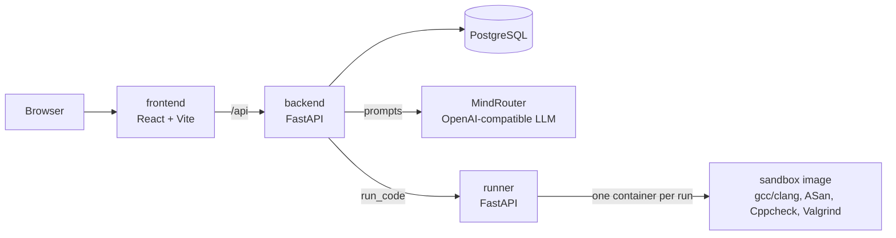

# Architecture

An AI tutor for secure C coding. A student picks a difficulty, the system
generates a C program with a memory-safety bug, and the student fixes it with
hints. Tools, not the AI, decide whether the fix is correct.

> Status: Phase 1 (skeleton). Every service exists and runs, but only health
> checks work. Sections marked *planned* describe Phase 3.

## Components



| Service | Folder | Tech | Job |
|---|---|---|---|
| frontend | `frontend/` | React, TypeScript, Vite, TanStack Query; later Monaco, React Router, Tailwind + shadcn/ui | Student UI: editor, hints, results |
| backend | `backend/` | Python 3.12, FastAPI, Pydantic; later SQLAlchemy 2 + Alembic, OpenAI SDK | Exercises, hints, grading, students, auth |
| runner | `runner/` | Python 3.12, FastAPI | Runs code in sandbox containers behind one interface |
| sandbox | `sandbox/` | Ubuntu image with gcc, clang, ASan/UBSan, Cppcheck, Valgrind | Where untrusted code actually runs |
| db | (image) | PostgreSQL 17 | Students, exercises, attempts, weaknesses |

## Design rules

1. **The reference fix never leaves the server.** It's stored in the database
   and used for validation and hint generation. API responses never include it.
2. **Every exercise is validated before a student sees it.** The original
   program must fail under ASan with the triggering input, and the reference
   fix must pass. If either check fails, regenerate.
   `sandbox/smoke-test.sh` does this check today for one hand-written example.
3. **Tools grade, not the AI.** A fix is accepted when the tests pass, ASan/UBSan
   are clean, and there are no *new* Cppcheck or Valgrind findings compared with
   the reference fix.
4. **Hints escalate** (concept → area of the code → line). A filter blocks hints
   that leak the fix, and off-topic or exploit-writing requests are refused.

## Sandbox

All student and generated code runs in a fresh container from the `sandbox`
image, started with:

| Flag | Why |
|---|---|
| `--network none` | code can't reach anything |
| `--read-only` + `--tmpfs /tmp` (64 MB) | only a small scratch area is writable |
| `--user 10001`, `--cap-drop ALL`, `no-new-privileges` | no root and no privilege escalation |
| `--memory 512m`, `--cpus 1`, `--pids-limit 64` | no resource exhaustion or fork bombs |
| `timeout` | infinite loops are killed |

The runner hides this behind one interface (`runner/app/sandbox.py`):

```python
class Sandbox(ABC):
    def run_code(self, source: str, tests: list[TestCase]) -> RunResult: ...
```

Today it's a stub, and `POST /run` returns 501. *Planned:* a `DockerSandbox`
using the flags above (the runner will need access to the Docker daemon), and
later a `KubernetesJobSandbox` if we deploy to OIT's Kubernetes. gVisor
(`--runtime=runsc`) is an extra layer to add if the host allows it.

LeakSanitizer is turned off inside the sandbox because it needs `ptrace`, which
is blocked. Valgrind covers leaks instead.

## Exercise lifecycle *(planned)*

1. Student picks a difficulty, and the backend chooses a bug type based on the
   student's weaknesses.
2. The backend asks MindRouter for the vulnerable program, the reference fix,
   tests and a triggering input (structured JSON output).
3. Guardrails check the output (no real exploit payloads, C only, size limits).
4. The runner validates it (rule 2). On failure, regenerate.
5. The student gets the vulnerable code and tests only.
6. Each submission goes to the runner, and the backend grades it (rule 3).
7. Results update the student's weakness profile.

## Local ports (docker-compose.yml)

| Service | Port | Exposed to host |
|---|---|---|
| frontend | 5173 | 127.0.0.1 only |
| backend | 8000 | 127.0.0.1 only |
| runner | 8001 | 127.0.0.1 only |
| db | 5432 | no |

## Deployment *(planned)*

Target: a university VM running Docker Compose. When `main` changes, GitHub
Actions builds the images and pushes them to GHCR. A self-hosted runner on the
VM then pulls them, runs migrations, runs `docker compose up -d` and checks
health. To roll back, redeploy the previous image tag. The fallback is OIT's
Kubernetes with Argo CD, where sandbox runs become Kubernetes Jobs.
